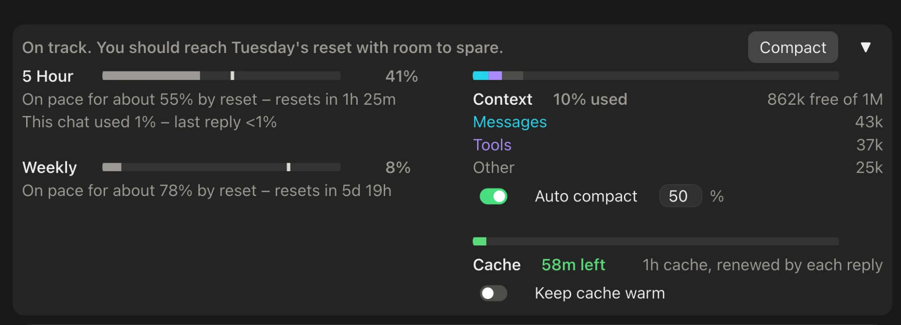

> [!NOTE]
> **This is a fork** of [usage-quota](https://github.com/4anti/claude-better-usage-mod) by Anant Raghunath (MIT). It adds a compact one-row band (only the bars; a click expands it), a **Cache** bar that counts down the prompt cache after each reply, a **Keep cache warm** switch and a wider Auto compact field. Install it with `/plugin marketplace add ba1234scx234s/claude-usage-band` and `/plugin install usage-quota@claude-usage-band`.

## See it in the app

Collapsed, the band is one row of bars: 5 hour and weekly limits with the time left until each resets, context window use, and how long the prompt cache has left. Click the bars to expand it.

Expanded, it adds the forecast to each reset, what this chat used, the context broken down into messages, tools and other, Compact and Auto compact, and the Cache countdown with Keep cache warm.

## Why Context and Cache matter

The 5 Hour and Weekly bars tell you how much you have left. **Context** and **Cache** tell you how fast a chat spends it.

**Context.** Every reply sends the whole conversation back to the model: your messages, Claude's replies, every file it read and every tool result. A chat at 60% context costs far more per reply than the same question in a fresh chat, and answers get worse as the window fills up, because older details get crowded out or compacted away. The Context bar shows how full the window is, so you can compact or start a new chat before a long session quietly eats your limits.

**Cache.** Claude caches the start of the conversation after each reply. While the cache is alive, the next reply reads that part at a fraction of the normal cost. Once it expires (after 5 minutes, or 1 hour on some plans), the next reply has to send the whole context again at full price, which in a long chat can use a big chunk of your 5 Hour limit in one go. The Cache bar counts down how long the cache has left: green just after a reply, through yellow and orange, red when it has expired. Reply before it runs out, or switch on **Keep cache warm** so the chat re-reads the cache just before it lapses.

Together they answer "is this the moment to continue, compact, or start fresh?" before you send the next message.

